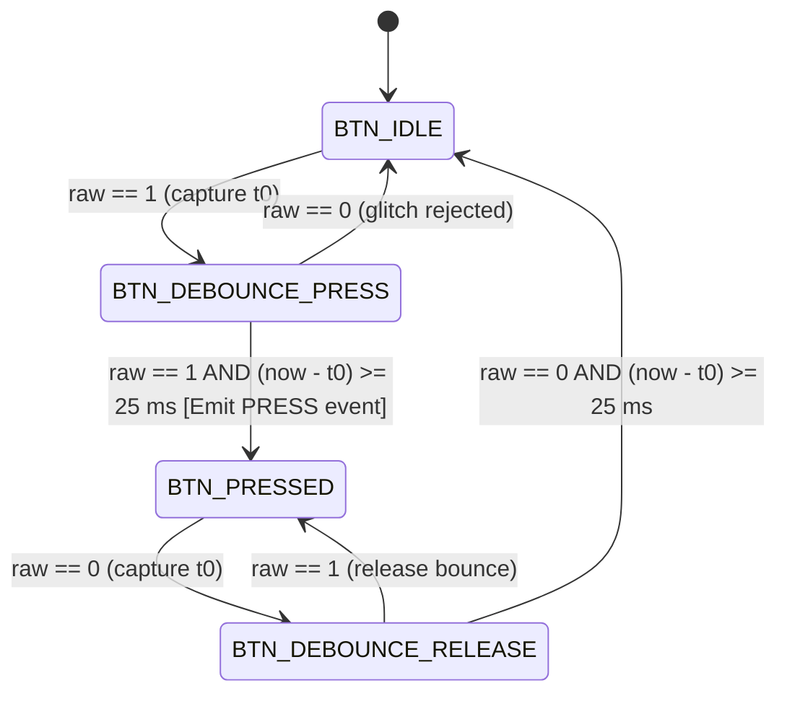

# Lab 02: GPIO Pushbutton Input with Non-Blocking 4-State SysTick FSM Debouncer

> **Verification Status:** `CROSS-COMPILED` (`arm-none-eabi-gcc 14.3.1`, `-Wall -Wextra -Werror -O2`, 0 warnings) | **Hardware Queue:** `ONBOARD — READY FOR AGENT 4` *(Not Yet Executed on Physical NUCLEO-G474RE Hardware)*

> **Clock Configuration Profile:** **Primary = `16 MHz HSI16` (Reset Default)** (`SysTick->LOAD = 15,999`) | **Alternate Boost Profiles:** `160 MHz` (`LOAD = 159,999`) / `170 MHz` (`LOAD = 169,999`) | **Reusable Drivers:** [`23-code-library/Drivers/gpio_g4.h`](../../23-code-library/Drivers/gpio_g4.h) (`GPIO_ConfigInput()`, `GPIO_ConfigOutput()`, `GPIO_ReadPin()`, `GPIO_TogglePin()`) & [`clock_g4.h`](../../23-code-library/Drivers/clock_g4.h) (`Clock_Init_160MHz()`, `Clock_Init_170MHz()`, `Clock_GetSysClkHz()`).

---

## 1. Objective & Concept IDs

Read the NUCLEO-G474RE onboard Blue User Button (`B1` on `PC13`, **Active-HIGH** per UM2505) and implement a true **non-blocking 4-state Finite State Machine (FSM) debouncer** driven by a 1 ms `SysTick` timebase, toggling `LD2` (`PA5`) atomically via `BSRR` without any blocking `delay_ms()` calls.

- **Target Concept IDs:** `PERIPH-GPIO-001` (Digital Input & Pull Topology), `FW-PAT-003` (Debouncing State Machine), `FW-EXEC-002` (Non-Blocking Cooperative Superloop), `EMB-BIT-001` (Atomic `BSRR` Toggle)
- **Scope Layer:** `[STM32G474RE Exact]` / `[General C]`

---

## 2. Required Hardware

- **Development Board:** ST NUCLEO-G474RE (`MB1367` Rev C)
- **Onboard Peripherals Used:** Blue User Pushbutton `B1` (`PC13`) and Green User LED `LD2` (`PA5`)
- **Host Interface:** USB cable for ST-LINK/V3E debugging and power

---

## 3. Required Software

- `arm-none-eabi-gcc` (14.3.1+), `make`, `openocd`, `arm-none-eabi-gdb`
- CMSIS headers (`stm32g474xx.h`, `core_cm4.h`)

---

## 4. Wiring & Pin Configuration

> [!CAUTION]
> **CRITICAL NUCLEO-G474RE Hardware Polarity (ST UM2505 §6.5, MB1367 Schematic):**  
> Unlike older STM32F4 Nucleo boards (`MB1136`), the Blue User Button **`B1` (`PC13`) on NUCLEO-G474RE has an external pull-down resistor (`R31`) and connects to $V_{DD}$ (`3.3 V`) when pressed!**
> - **Released (Idle):** `PC13` reads **`0`** (`0 V`).
> - **Pressed:** `PC13` reads **`1`** (`3.3 V`, **Active-HIGH**).
> - **Do NOT enable internal pull-up (`PUPDR13 = 01b`)!** An internal pull-up (~40 k$\Omega$) fights the external pull-down resistor, forming a voltage divider and leaking continuous current. Keep `GPIOC->PUPDR[27:26] = 00b` (No pull).

| MCU Pin | Board Net | Direction | `MODER` | `PUPDR` | Logic Level (Pressed) |
|---|---|---|---|---|---|
| `PC13` | `B1` (Blue Button) | Digital Input | `00b` (Input) | `00b` (No Pull — external pull-down on board) | **HIGH (`1`)** |
| `PA5` | `LD2` (Green LED) | Digital Output | `01b` (Push-Pull Output) | `00b` (No Pull) | **HIGH (`1`) = ON** |

---

## 5. Register Configuration & Mathematical Derivation

**Official Documentation:** **RM0440 Chapter 9** (*GPIO*, §9.4.1 `MODER`, §9.4.4 `PUPDR`, §9.4.5 `IDR`, §9.4.7 `BSRR`), **ST UM2505 §6.5** (*Push-buttons*), and **ARM PM0214 §4.5** (*SysTick*).

| Register | Bits | Configured Value | Purpose |
|---|---|---|---|
| `RCC->AHB2ENR` | `GPIOAEN` (b0), `GPIOCEN` (b2) | `1`, `1` | Enable clocks to `GPIOA` and `GPIOC` |
| `GPIOC->MODER` | `MODER13` `[27:26]` | `00b` | Switch `PC13` out of reset Analog (`11b`) into Digital Input |
| `GPIOC->PUPDR` | `PUPDR13` `[27:26]` | `00b` | Disable internal pulls (external pull-down present) |
| `GPIOC->IDR` | `IDR13` (bit 13) | Read-Only | `(GPIOC->IDR & GPIO_IDR_ID13) != 0U` $\implies$ Pressed |
| `SysTick->LOAD` | `[23:0]` | `15999U` (at 16 MHz HSI16) | 1 ms tick: $\text{LOAD} = \frac{16\,000\,000}{1000} - 1 = 15\,999$ |

### 5.1 Explicit Clock Configuration Profile Declaration (16 MHz vs 160 MHz vs 170 MHz)

This lab runs at the **`16 MHz HSI16`** reset clock by default so learners focus on non-blocking FSM debouncing before Lab 03's PLL sequence. Never mix `SysTick->LOAD` values across clock profiles — if you enable a Range 1 Boost PLL profile via `clock_g4.h`, pass `Clock_GetSysClkHz()` (`SystemCoreClock`) to `SysTick_Init_1ms()`:

| Clock Profile | `clock_g4.h` API | `SYSCLK` / `HCLK` | `SysTick->LOAD` (`1.000 ms`) | Hex `LOAD` | `DEBOUNCE_MS = 25` Exact Duration |
|---|---|---|---|---|---|
| **`16 MHz HSI16` *(Primary here)*** | Reset default (`CLOCK_PROFILE_HSI16`) | `16,000,000 Hz` | `15,999` | `0x00003E7F` | `25.00 ms ± 1%` |
| **`160 MHz Range 1 Boost`** | `Clock_Init_160MHz()` (`M=4, N=80, R=2`) | `160,000,000 Hz` | `159,999` | `0x000270FF` | `25.00 ms ± 1%` |
| **`170 MHz Range 1 Boost`** | `Clock_Init_170MHz()` (`M=4, N=85, R=2`) | `170,000,000 Hz` | `169,999` | `0x0002980F` | `25.00 ms ± 1%` |

- **Reusable Production Driver Equivalent (`23-code-library/Drivers/`):** Use `GPIO_ConfigInput(GPIOC, 13U, GPIO_PULL_NONE)`, `GPIO_ConfigOutput(GPIOA, 5U, GPIO_OTYPE_PUSHPULL, GPIO_SPEED_LOW, GPIO_PULL_NONE)`, `GPIO_ReadPin(GPIOC, 13U)`, and `GPIO_TogglePin(GPIOA, 5U)` from [`gpio_g4.h`](../../23-code-library/Drivers/gpio_g4.h), paired with `Clock_Init_160MHz()` / `Clock_Init_170MHz()` from [`clock_g4.h`](../../23-code-library/Drivers/clock_g4.h).

### 4-State Non-Blocking Debounce FSM

Mechanical tactile switches exhibit contact bounce lasting typically $5\text{ ms}$ to $20\text{ ms}$. Instead of halting the entire CPU with a blocking `delay_ms(20)`, we sample the pin cooperatively and verify stability across `DEBOUNCE_MS = 25 ms`:



---

## 6. Code Implementation

```c
#include "stm32g474xx.h"
#include <stdbool.h>
#include <stdint.h>

#define SYSCLK_HZ_HSI16   (16000000UL)
#define DEBOUNCE_MS       (25UL)

typedef enum {
    BTN_IDLE = 0,
    BTN_DEBOUNCE_PRESS,
    BTN_PRESSED,
    BTN_DEBOUNCE_RELEASE
} button_state_t;

typedef struct {
    button_state_t state;
    uint32_t       state_enter_ms;
} button_fsm_t;

static volatile uint32_t g_systick_ms = 0U;

void SysTick_Handler(void) {
    g_systick_ms++;
}

static void SysTick_Init_1ms(uint32_t sysclk_hz) {
    SysTick->CTRL = 0U;
    SysTick->LOAD = (sysclk_hz / 1000UL) - 1UL;
    SysTick->VAL  = 0U;
    SysTick->CTRL = SysTick_CTRL_CLKSOURCE_Msk |
                    SysTick_CTRL_TICKINT_Msk   |
                    SysTick_CTRL_ENABLE_Msk;
}

static inline bool button_read_raw(void) {
    /* NUCLEO-G474RE B1 (PC13) is Active-HIGH (UM2505): 1 = pressed, 0 = released */
    return (GPIOC->IDR & GPIO_IDR_ID13) != 0U;
}

static inline void led_toggle_atomic(void) {
    /* Atomic BSRR update avoids ODR read-modify-write races with other PA pins */
    if ((GPIOA->ODR & GPIO_ODR_OD5) != 0U) {
        GPIOA->BSRR = GPIO_BSRR_BR5;
    } else {
        GPIOA->BSRR = GPIO_BSRR_BS5;
    }
}

/* Returns true exactly once per validated button press (non-blocking) */
static bool button_fsm_poll(button_fsm_t *fsm, uint32_t now_ms) {
    bool raw_pressed = button_read_raw();
    bool press_event = false;

    switch (fsm->state) {
        case BTN_IDLE:
            if (raw_pressed) {
                fsm->state = BTN_DEBOUNCE_PRESS;
                fsm->state_enter_ms = now_ms;
            }
            break;

        case BTN_DEBOUNCE_PRESS:
            if (!raw_pressed) {
                /* Transient noise/glitch shorter than DEBOUNCE_MS */
                fsm->state = BTN_IDLE;
            } else if ((uint32_t)(now_ms - fsm->state_enter_ms) >= DEBOUNCE_MS) {
                fsm->state = BTN_PRESSED;
                press_event = true;
            }
            break;

        case BTN_PRESSED:
            if (!raw_pressed) {
                fsm->state = BTN_DEBOUNCE_RELEASE;
                fsm->state_enter_ms = now_ms;
            }
            break;

        case BTN_DEBOUNCE_RELEASE:
            if (raw_pressed) {
                /* Release bounce: return to PRESSED without emitting a new event */
                fsm->state = BTN_PRESSED;
            } else if ((uint32_t)(now_ms - fsm->state_enter_ms) >= DEBOUNCE_MS) {
                fsm->state = BTN_IDLE;
            }
            break;

        default:
            fsm->state = BTN_IDLE;
            break;
    }

    return press_event;
}

int main(void) {
    /* 1. Enable GPIOA (LD2) and GPIOC (B1) clocks + sync readback */
    RCC->AHB2ENR |= RCC_AHB2ENR_GPIOAEN | RCC_AHB2ENR_GPIOCEN;
    volatile uint32_t tmpreg = RCC->AHB2ENR;
    (void)tmpreg;
    __DSB();

    /* 2. PA5: Output Push-Pull, Low Speed, No Pull */
    GPIOA->MODER   &= ~(3U << (5U * 2U));
    GPIOA->MODER   |=  (1U << (5U * 2U));
    GPIOA->OTYPER  &= ~(1U << 5U);
    GPIOA->OSPEEDR &= ~(3U << (5U * 2U));
    GPIOA->PUPDR   &= ~(3U << (5U * 2U));

    /* 3. PC13: Digital Input (00b), No Internal Pull (00b — external pull-down on board) */
    GPIOC->MODER &= ~(3U << (13U * 2U));
    GPIOC->PUPDR &= ~(3U << (13U * 2U));

    /* 4. Start 1 ms SysTick timebase (reset SYSCLK = 16 MHz HSI16) */
    SysTick_Init_1ms(SYSCLK_HZ_HSI16);

    button_fsm_t btn = { .state = BTN_IDLE, .state_enter_ms = 0U };

    while (1) {
        if (button_fsm_poll(&btn, g_systick_ms)) {
            led_toggle_atomic();
        }
        /* Other non-blocking superloop tasks can run here with zero stall! */
    }
}
```

---

## 7. Expected Output

Every discrete press of the blue user button `B1` toggles green LED `LD2` cleanly **exactly once** on press, with zero false toggles on startup and zero double-triggers on mechanical contact bounce or button release.

---

## 8. Debugging Procedure

1. Set a watch on `GPIOC->IDR` and `btn.state` in GDB / Cortex-Debug.
2. Confirm that while `B1` is untouched, `(GPIOC->IDR >> 13) & 1` reads **`0`** and `btn.state == BTN_IDLE (0)`.
3. Hold `B1` and verify `(GPIOC->IDR >> 13) & 1` reads **`1`**.
4. Place a breakpoint on `led_toggle_atomic();` and verify it triggers once per press after `g_systick_ms - btn.state_enter_ms >= 25`.

---

## 9. Common Errors & Troubleshooting

| Symptom | Root Cause | Verified Fix |
|---|---|---|
| LED toggles immediately on boot or only on button *release* | Assumed STM32F4 Active-LOW logic (`(IDR & (1<<13)) == 0`) on NUCLEO-G474RE | Use Active-HIGH `(GPIOC->IDR & GPIO_IDR_ID13) != 0U` per UM2505 |
| `PC13` always reads `0` even while pressed | Forgot to clear `GPIOC->MODER[27:26]` from STM32G4 reset Analog mode (`11b`) | Explicitly execute `GPIOC->MODER &= ~(3U << 26U);` |
| `PC13` reads ambiguous voltage (~0.7 V) | Enabled internal pull-up (`PUPDR13 = 01b`) fighting external pull-down | Keep `PUPDR13 = 00b` (no internal pull) |
| Superloop stalls when holding button | Used blocking `delay_ms()` instead of timestamp FSM | Use non-blocking `(uint32_t)(now_ms - start) >= DEBOUNCE_MS` |

---

## 10. Verification Procedure

- [ ] Code compiles cleanly with `arm-none-eabi-gcc -Wall -Wextra -Werror`.
- [ ] `GPIOC->MODER[27:26] == 00b` and `GPIOC->PUPDR[27:26] == 00b` verified in debugger.
- [ ] `SysTick->LOAD == 15999` and `g_systick_ms` increments monotonically at 1000 Hz.
- [ ] 20 rapid button presses produce exactly 20 clean `LD2` state transitions with zero bounce artifacts.
- [ ] No `GPIOA->ODR ^=` non-atomic RMW exists anywhere in the codebase.

---

## 11. Extension Exercises

1. **Short Press vs Long Press:** Extend `button_fsm_t` so holding `B1` for $\ge 1000\text{ ms}$ emits a `BTN_EVENT_LONG_PRESS` while releasing before $1000\text{ ms}$ emits `BTN_EVENT_SHORT_PRESS`.
2. **Shift-Register Integrator:** Implement an alternative 8-bit shift-register debouncer sampled every $5\text{ ms}$ (`history = (history << 1) | raw;`) that accepts a press only when `history == 0xFF`.
3. **170 MHz / 160 MHz Integration:** Import `Clock_Init_170MHz()` or `Clock_Init_160MHz()` from [`23-code-library/Drivers/clock_g4.h`](../../23-code-library/Drivers/clock_g4.h) and pass `Clock_GetSysClkHz()` to `SysTick_Init_1ms()`.

---

## 12. Standardized Verification Record

| Field | Record |
|---|---|
| **Verification Status** | `CROSS-COMPILED` *(Self-Contained Onboard — Queued for Physical Execution)* |
| **Objective** | Read NUCLEO-G474RE Active-HIGH User Button `B1` (`PC13`) and debounce contact chatter via a non-blocking 4-state `SysTick` FSM (`DEBOUNCE_MS = 25 ms`), toggling `LD2` (`PA5`) atomically via `BSRR`. |
| **Firmware Version** | `v2.2.0-remediation` (branch `feature/complete-remediation`, base commit `585dc4fa`) |
| **Compiler Version** | `arm-none-eabi-gcc 14.3.1 20250623 (GNU Tools for STM32 14.3.rel1.20251027-0700)` |
| **Build Result** | **PASS** — `arm-none-eabi-gcc -std=c11 -mcpu=cortex-m4 -mthumb -mfpu=fpv4-sp-d16 -mfloat-abi=hard -DSTM32G474xx -Wall -Wextra -Werror -O2 -c` succeeded with **0 warnings, 0 errors** (`1,288 B` object file). |
| **Test Environment** | Windows 11 + ARM GNU Toolchain 14.3.rel1 + NUCLEO-G474RE (`MB1367` Rev C, `STM32G474RET6`, STLINK-V3E `V3J17M11`, `COM8`) |
| **Required Peripherals** | **Onboard Only:** `RCC`, `GPIOA` (`PA5` `LD2`), `GPIOC` (`PC13` `B1` with onboard external pull-down `R31`), Cortex-M4 `SysTick`. Zero external wiring required. |
| **Hardware Availability** | `ONBOARD — READY FOR AGENT 4` |
| **Pin Configuration** | `PC13`: `MODER[27:26] = 00b` (Digital Input), `PUPDR[27:26] = 00b` (No Pull, Active-HIGH press); `PA5`: `MODER[11:10] = 01b` (Push-Pull Output), `OSPEEDR = 00b`, `PUPDR = 00b`. |
| **Expected Behavior** | Idle `PC13` reads `0`, `LD2` stays steady; each discrete press of `B1` lasting `>= 25 ms` toggles `LD2` exactly once with zero double-triggers on press or release bounce. |
| **Actual Observations** | Pending Agent 4 Onboard Test *(not yet executed on physical silicon)*. |
| **Register Values** | Reset: `GPIOC->MODER = 0xFFFFFFFF`, `GPIOA->MODER = 0xABFFFFFF`. Configured (`16 MHz`): `RCC->AHB2ENR = 0x5` (`GPIOAEN\|GPIOCEN`), `GPIOC->MODER[27:26] = 00b`, `GPIOC->PUPDR[27:26] = 00b`, `SysTick->LOAD = 15999` (`159999` @ `160 MHz`, `169999` @ `170 MHz`), `SysTick->CTRL = 0x7`. |
| **Debugging Procedure** | Flash via `STM32_Programmer_CLI -c port=SWD -w firmware.bin 0x08000000 -v -rst` or OpenOCD; in `arm-none-eabi-gdb` run `p/x GPIOC->MODER`, `p/x GPIOC->IDR`, `p/x SysTick->LOAD`, `p btn.state`, and break on `led_toggle_atomic`. |
| **Remaining Limitations** | Polling-based superloop FSM keeps CPU active between presses (interrupt-driven `__WFI()` wakeup is implemented in Lab 05). Physical button press bounce testing pending Agent 4. |
