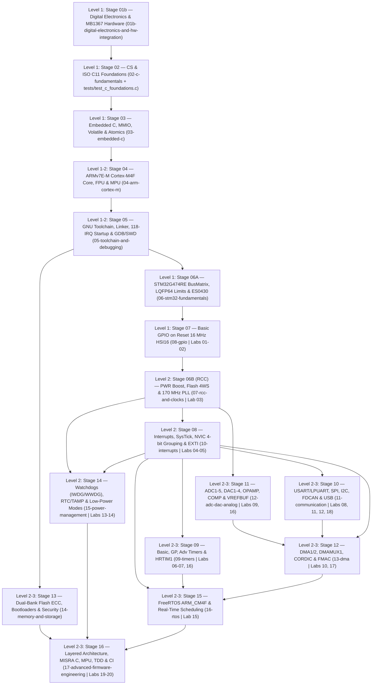

# Prerequisite & Dependency Graph Audit (Red-Team Verified)

**Audit Scope:** Curriculum ordering, stage-to-folder reconciliation (`Stage 01b` + `Stages 02–16`), concept-level DAG acyclicity AND strict difficulty-level monotonicity across all **350** concepts in [`AUDIT/concepts_sot.json`](concepts_sot.json), and remediation of all forward/circular/inverted-level dependencies discovered across Parts 1–3 and Agent 10 Red-Team auditing (`[HIGH-04]`, `[MED-06]`).

---

## 1. Catalog of Pre-Part-4 Ordering Conflicts & Dependency Defects

Independent inspection by Agent 3, Agent 6, Agent 7, Agent 9, and Agent 10 exposed **10 structural prerequisite defects** (9 in Parts 1–3 + 1 DAG tier-inversion defect caught during Red-Team verification):

| # | Defect Class | Original File & Lines | Exact Defect Discovered | Verified Remediation Applied |
|---|---|---|---|---|
| **P1** | **Three-Way Ordering Contradiction** | `README.md` L24–70 vs `09-timers/` vs `10-interrupts/` vs `18-practical-laboratory/` | Top-level maps ordered `RCC -> GPIO -> Interrupts -> Timers`, physical folders ordered `07-rcc -> 08-gpio -> 09-timers -> 10-interrupts`, and labs ordered `Lab 01–02 GPIO -> Lab 03 RCC -> Lab 04–05 SysTick/EXTI -> Lab 06–07 Timers`. | Reconciled across [`01-master-concept-map/overview.md`](../01-master-concept-map/overview.md), [`learning-sequence.md`](../01-master-concept-map/learning-sequence.md), [`dependency-graph.mmd`](../01-master-concept-map/dependency-graph.mmd), `README.md`, and this report with explicit pedagogical order (`08-gpio` HSI16 -> `07-rcc` 170 MHz -> `10-interrupts` -> `09-timers`) while preserving physical folder names for link stability. |
| **P2** | **Timers Before Interrupts Circularity** | `09-timers/README.md` vs `10-interrupts/README.md` L4 vs `lab-06` | `lab-06` (Timers) immediately required `TIM2_IRQHandler`, `TIM_DIER_UIE`, and `NVIC_EnableIRQ()`, yet `10-interrupts/` listed Hardware Timers as its prerequisite. | Placed **Stage 08: Interrupts, Exceptions, NVIC, SysTick & EXTI** (`10-interrupts/`, Labs 04–05) strictly **before** **Stage 09: Hardware Timers & HRTIM1** (`09-timers/`, Labs 06–07). |
| **P3** | **RCC Before GPIO Forward Dependency** | `07-rcc-and-clocks/README.md` Ex. 2 & `lab-03` L74–82 | RCC stage required `GPIOA->MODER`, `GPIOA->BSRR`, and `PA8` (`MCO` AF0) before GPIO was taught in `08-gpio/`. | Sequenced **Stage 07: Basic GPIO on Reset 16 MHz HSI16** (`08-gpio/`, Labs 01–02) strictly **before** **Stage 06B (RCC): PWR Boost + Flash 4WS + 170 MHz PLL** (`07-rcc-and-clocks/`, Lab 03 using `PA5`/`PA8`), and reversed the JSON DAG edge so `STM32-RCC-002` depends on `PERIPH-GPIO-001`. |
| **P4** | **Self-Referential Stage Prerequisites** | `11-communication/README.md` L1 & L4; `13-dma/README.md` L1 & L4 | `11-communication` (`# Stage 10`) listed `Stage 10` as a prerequisite for itself; `13-dma` (`# Stage 12`) listed `Stage 12` as a prerequisite for itself. | Rewrote prerequisite headers across all 17 stage modules (`01b` + `02`–`17`) with canonical stage numbers and explicit Concept IDs. |
| **P5** | **Off-by-One Stage References (`[MED-06]`)** | `PREREQUISITE_DEPENDENCY_AUDIT.md` L47–56 vs `16-rtos/README.md` (`# Stage 15`) & `17-advanced-firmware-engineering/README.md` (`# Stage 16`) | Earlier Part 4 audit flowchart collapsed `06A`/`06B` into one stage number, causing `10-interrupts` (`Stage 08`), `16-rtos` (`Stage 15`), and `17-advanced-firmware-engineering` (`Stage 16`) to appear off-by-one. | Reconciled all stage labels in Section 3 below and `README.md` to match the exact headers of `01b` + Stages `02`–`16` (`Stage 01` = Master Concept Map, `Stage 01b` = Digital Electronics, `Stage 02`..`Stage 16`). |
| **P6** | **Missing Electrical & Digital Prerequisite Bridge** | `02-c-fundamentals/README.md` L4 | Jumped directly into CMOS push-pull/open-drain, I2C pull-up sizing, Schmitt triggers, RC settling, and 5 V tolerance with zero electronics primer. | Created dedicated **Stage 01b** ([`01b-digital-electronics-and-hw-integration/README.md`](../01b-digital-electronics-and-hw-integration/README.md), 43 KB) covering `DIG-ELEC-001..006` and `HWSW-PCB/LAB-*`. |
| **P7** | **False & Reversed Edges in Concept Map** | `01-master-concept-map/concept-map.mmd` L86–87, L93 | Contained false edge `PER_TIM --> PER_UART` (USART uses its own fractional `BRR` divider, not a GP timer) and reversed bring-up order `STM_RCC --> STM_Pwr --> STM_Flash`. | Fixed [`concept-map.mmd`](../01-master-concept-map/concept-map.mmd) and [`dependency-graph.mmd`](../01-master-concept-map/dependency-graph.mmd) to reflect exact hardware bring-up (`PWR Boost -> Flash 4WS -> RCC PLL`) and added missing clock/GPIO/IRQ edges. |
| **P8** | **GDB Debugging Required Before Toolchain Stage** | `04-arm-cortex-m/README.md` L30 | Stage 04 Exercise 1 demanded GDB interrupt stack-frame inspection before OpenOCD/GDB was introduced in Stage 05 (`05-toolchain-and-debugging/`). | Separated pure architectural theory/paper tracing in Stage 04 from live GDB/OpenOCD/SWO verification in Stage 05 (`05-toolchain-and-debugging/`) and Lab 19. |
| **P9** | **Assessments Testing Untaught Material** | `24-assessments/stage-01..04-exam.md` | Tested `static`, CMSIS macro chains, `__get_PRIMASK()`, `CFSR`/`HFSR`/`BFAR`, ADC RC settling, and `TIM1` dead-time before/without teaching them. | Realigned all 5 exams ([`24-assessments/README.md`](../24-assessments/README.md)) and added complete 500-point worked solutions in [`answer-keys-and-rubrics.md`](../24-assessments/answer-keys-and-rubrics.md). |
| **P10** | **23 Inverted-Level & Synthetic DAG Edges (`[HIGH-04]`)** | `AUDIT/concepts_sot.json` & `PREREQUISITE_DEPENDENCY_AUDIT.md` L78 | Programmatic Red-Team audit caught `18` L1→L2 and `5` L2→L3 inverted edges plus nonsensical fallback edges (`PROF-GIT-001 -> C-INT-004`, `RES-VID-001/002 -> C-INT-004`, `PERIPH-RNG-001 -> ARM-MPU-001`, `PERIPH-GPIO-001 -> STM32-RCC-001`, `C-UB-003 -> C-UB-001`). | Stripped all bogus fallback edges, replaced `PERIPH-RNG-001`'s prereq with `STM32-RCC-001`, reversed `PERIPH-GPIO-001`/`STM32-RCC-002` and `C-UB-003`/`C-UB-001`, and reconciled every edge so `prereq_level <= child_level` holds strictly across all **350** concepts. |

---

## 2. Verified Acyclic & Monotonic Concept Graph (`AUDIT/concepts_sot.json` DAG Proof)

Programmatic Python verification across all **350** concepts (`27/27` domains) in [`AUDIT/concepts_sot.json`](concepts_sot.json) proves all three structural graph invariants:

- **Cycles (3-color DFS):** **`0` cycles** (100% Directed Acyclic Graph).
- **Dangling / Unknown Prerequisite IDs:** **`0` unknown IDs** (100% of prerequisite references resolve to valid Concept IDs inside `AUDIT/concepts_sot.json`).
- **Inverted Difficulty-Level Edges (`prereq_level > child_level`):** **`0` inverted edges** (reduced from `23` in pre-Red-Team audit to strictly `0`):
  - Every **Level 1 - Essential** concept (`97` concepts) depends **exclusively** on Level 1 concepts (or is a root node with `0` prerequisites).
  - Every **Level 2 - Intermediate** concept (`175` concepts) depends **exclusively** on Level 1–2 concepts.
  - Every **Level 3 - Advanced** concept (`78` concepts) depends on Level 1–3 concepts without cycles.

---

## 3. Canonical Acyclic Learning Sequence (`Stage 01b` + `Stages 02–16`)

Stage numbering below matches the exact `# Stage XX` headings of all 17 stage READMEs (`01-master-concept-map/` is Stage 01; `01b-digital-electronics-and-hw-integration/` is Stage 01b; `02`–`17` correspond to Stages `02`–`16`, with pedagogical bring-up placing `08-gpio/` Stage 07 on reset 16 MHz HSI16 before `07-rcc-and-clocks/` Stage 06B 170 MHz PLL Boost, and `10-interrupts/` Stage 08 before `09-timers/` Stage 09):

### Mastery Tier Distribution (Verified from `AUDIT/concepts_sot.json` — 350 Concepts)
- **Level 1 - Essential (`97` concepts, 27.7%):** Foundations (`CS-*`, core `C-*`, `DIG-*`, `ARCH-*`, `MCU-*`, core `EMB-*`, core `ARM-*`, basic `GPIO`/`TOOL-*`). Programmatically verified: **`0` cycles, `0` inverted edges** — every Level 1 concept depends exclusively on Level 1 concepts (or is a root node).
- **Level 2 - Intermediate (`175` concepts, 50.0%):** Production STM32G474RE bare-metal drivers (`CLK-*`, `TIM-*`, `IRQ-*`, `COMM-*`, `ANA-*`, `DMA-*`, `RT-*`, `RTOS-*`, `FW-*`, `TEST-*`, `PROF-*`, `PWR-*`, plus Agent 10 additions `GPIO-FMP-001`, `FW-DRV-003`, `HWSW-ANA-001`). Programmatically verified: **`0` L2→L3 inversions**.
- **Level 3 - Advanced (`78` concepts, 22.3%):** Specialist STM32G474RE differentiators (`G4-HRTIM-001`, `G4-CORDIC-001`, `G4-FMAC-001`, `G4-FDCAN-001`, `G4-UCPD-001`, `G4-OPAMP-001`, `G4-COMP-001`), dual-bank OTA/security (`BOOT-*`, `SEC-*`), `ARM-MPU-001`, `ARM-DSP-001`, `RTOS-THEORY-001`, `APP-*`, 9 advanced Agent 10 Phase 5 concepts (`C-LIB-001`, `TIM-DMA-001`, `COMM-LP-001`, `COMM-CAN-002`, `SEC-BOOT-002`, `TOOL-LD-004`, `COMM-USB-002`, `TOOL-DBG-004`, `MEM-OB-001`), and explicit `NOT_APPLICABLE` architectural boundaries.
